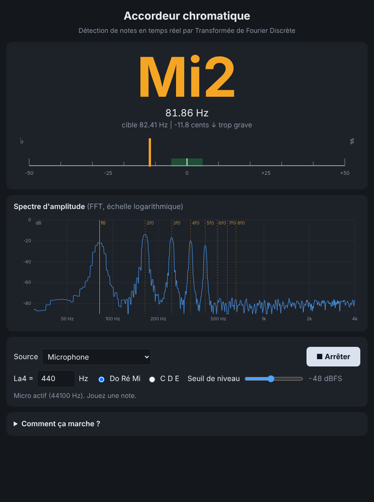

# Accordeur chromatique temps réel — version JavaScript

Détecteur de notes et accordeur chromatique **dans le navigateur**, basé sur la **Transformée de Fourier
Discrète**. Aucune installation, aucune dépendance : la FFT est **écrite à la main** (Cooley-Tukey radix-2)
et le micro est lu avec la Web Audio API.



*Capture réalisée avec un faux micro lisant un Mi grave de guitare (82 Hz) légèrement bas (−12 cents).*

## Fonctionnalités

- Note détectée (Do Ré Mi ou C D E), fréquence fondamentale, écart en **cents** et jauge de justesse
- Spectre d'amplitude en temps réel (échelle logarithmique) avec repérage de f0 et de ses harmoniques
- Diapason réglable (La4 = 400–480 Hz), seuil de niveau réglable
- Source : micro **ou signal de test synthétique** (démonstration possible sans micro)
- Micro lu avec `echoCancellation`, `noiseSuppression` et `autoGainControl` désactivés (ils altèrent le signal)

## Utilisation

Ouvrir [`index.html`](index.html) dans Chrome, Edge ou Firefox (double-clic), choisir *Microphone* ou
*Signal de test* puis **Démarrer**. Le navigateur demande l'autorisation d'accès au micro.

Hors `file://`, la page doit être servie en `https://` ou sur `localhost` pour accéder au micro :

```bash
python -m http.server 8000        # puis http://localhost:8000
# ou, avec Node :  npm run serve
```

Astuce démonstration : `index.html?source=synth&freq=443&autostart=1` démarre directement le signal de test.

### Publication en ligne (GitHub Pages)

Le workflow [`pages.yml`](.github/workflows/pages.yml) publie la page automatiquement à chaque push sur `main` :
*Settings → Pages → Source : GitHub Actions*, puis `https://<utilisateur>.github.io/<depot>/`.

## Principe de fonctionnement

1. **Capture** : l'`AnalyserNode` fournit les 8192 derniers échantillons (≈ 170–190 ms selon 44,1 / 48 kHz).
2. **Prétraitement** : suppression de la composante continue, niveau RMS (silence → pas de note).
3. **Fenêtre de Hann** : atténue les bords de la trame pour limiter les fuites spectrales.
4. **Transformée de Fourier Discrète** :

   `X[k] = Σ x[n] · e^(−2πi·k·n/N)` , calculée par FFT en O(N log N) après un bourrage de zéros ×2
   (NFFT = 16384, pas fréquentiel `Δf = fs / NFFT ≈ 2,7–2,9 Hz`). Le spectre est normalisé : un sinus
   d'amplitude A donne un pic d'amplitude A.
5. **Extraction de la fondamentale** (le pic le plus haut n'est pas toujours la fondamentale : sur une
   guitare ou une voix, le 2ᵉ harmonique est souvent plus fort) :
   - **produit spectral harmonique (HPS)** : on cherche `f` telle que `f, 2f, 3f, 4f, 5f` portent toutes de
     l'énergie, en sommant les logarithmes des amplitudes, avec un plancher de bruit adaptatif et un poids
     double sur `f` pour départager les sons purs ;
   - **correction d'octave** : si la sous-harmonique `f/2` est déjà nettement présente, c'est elle la fondamentale ;
   - **interpolation parabolique** du pic sur le logarithme de l'amplitude : la précision passe de
     ±2,7 Hz (résolution de la FFT) à moins de 0,1 Hz.
6. **Fréquence → note** : `midi = 69 + 12·log₂(f / La4)`, `cents = 100·(midi − round(midi))`
   (1 cent = 1/100 de demi-ton). Numérotation scientifique : La4 = 440 Hz, Do4 = Do central.

Les paramètres (taille de trame, plage 40–2000 Hz, harmoniques du HPS, seuils) sont dans `DSP.DEFAULTS`
([`dsp.js`](dsp.js)).

## Tests

```bash
npm test          # ou : node --test tests/dsp.test.js   (Node 18+, aucune dépendance à installer)
```

48 tests : FFT = DFT directe, relation de Parseval, conversion fréquence → note, **précision de la
fondamentale sur 1 488 signaux synthétiques** (6 timbres dont fondamentale faible / harmoniques impairs /
son pur, fs = 44,1 et 48 kHz, avec et sans bruit, de 55 Hz à 1,9 kHz, erreur < 5 cents), rejet du bruit et
du silence. La page a aussi été vérifiée dans Chrome avec un faux micro alimenté par un fichier WAV.

## Limites connues

- **Monophonique** : un seul son à la fois (pas de détection d'accords).
- Plage par défaut 40 Hz – 2 kHz ; en dessous de 40 Hz la trame ne contient que quelques périodes.
- Latence ≈ 190 ms (durée d'une trame) : compromis entre réactivité et résolution des graves.
- Le HPS peut se tromper d'octave sur des timbres atypiques ; les instruments inharmoniques
  (piano aigu, cloches) sont moins précis.
- Un micro d'ordinateur portable ou un environnement bruyant dégrade la détection : ajuster le *seuil de niveau*.

## Structure

```
index.html, style.css, app.js   interface (micro, jauge, spectre)
dsp.js                          FFT, HPS, interpolation, conversion en notes (aucune dépendance)
tests/dsp.test.js               tests Node
docs/                           capture d'écran
.github/workflows/              CI (tests) + déploiement GitHub Pages
```

## Publier sur GitHub

Créer un dépôt vide sur github.com (sans README), puis depuis ce dossier :

```bash
git init
git add .
git commit -m "Accordeur chromatique FFT (JavaScript)"
git branch -M main
git remote add origin https://github.com/<utilisateur>/<depot>.git
git push -u origin main
```
